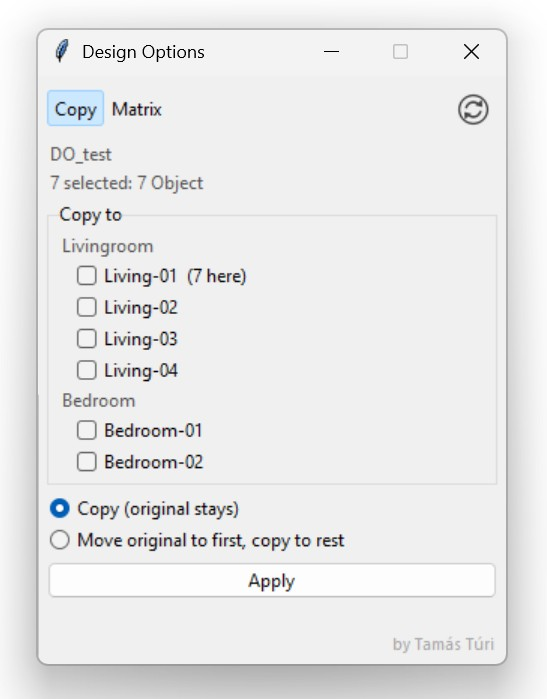
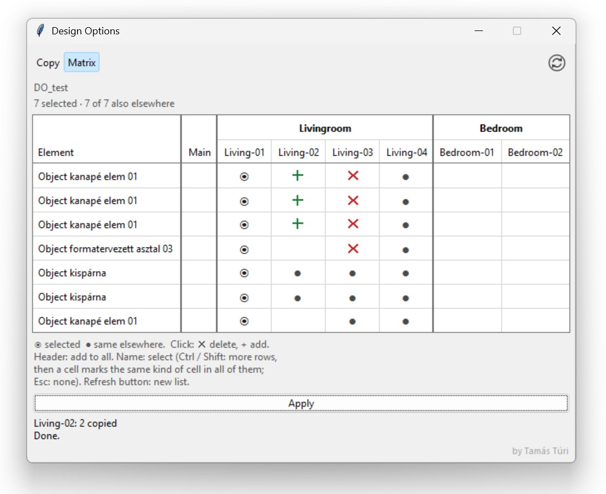

Design Options – a Tapir script

Copy tab
- Copies the selected elements into one or more design options in one step.
- Optional: move the original to the first ticked option and copy it to the rest.

Matrix tab
- For the selected elements, shows where an identical element exists: main model and every option, grouped by set (◉ selected, ● identical elsewhere).
- Click a cell to mark delete (✕) or add (+), then Apply.
  "Identical" means same type, story, layer, ID, geometry, settings and GDL parameters.

Requirements and limits
- Archicad 29+ with Tapir 1.7.0+. Tested on Archicad 30 (Windows). Teamwork is not supported yet.
- A single .py file, no extra packages: copy it to Documents\Tapir\custom-scripts and run it from the Tapir palette.
- Elements are copied one by one, so connections between them (wall junctions, SEOs, associative dimensions/labels) are not recreated in the copies.

Idea: Tamás Túri – coded with Claude Opus 5.5 (Anthropic). Free to use and modify, provided the original author is credited.
